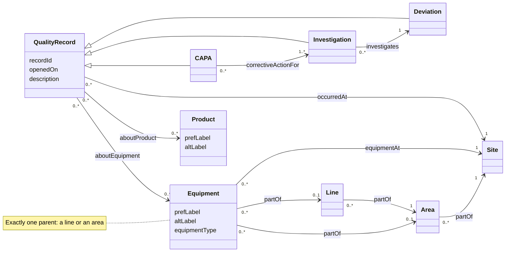
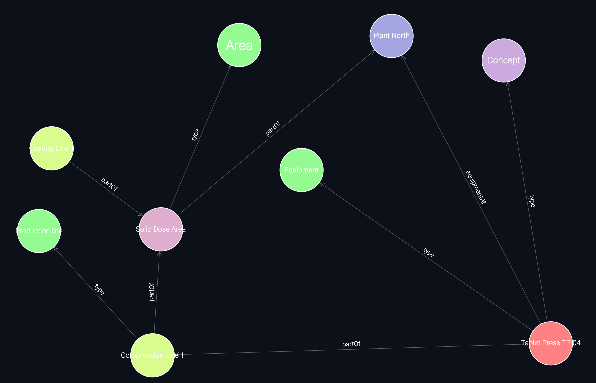
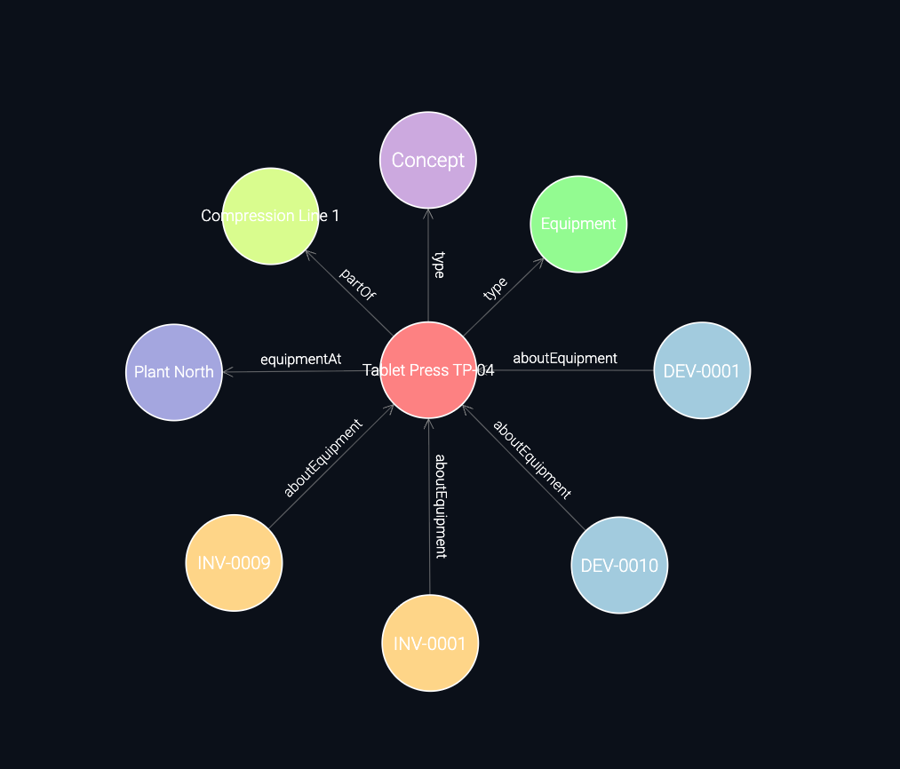

# qms-knowledge-graph

A small, **fully synthetic** knowledge graph for a problem that comes up in regulated manufacturing: quality
records (deviations, investigations, corrective actions) name the same product or machine in different ways,
so records that belong together are hard to find.

The project models that domain as an ontology and a controlled vocabulary, links messy free text to the
vocabulary with a human review step, validates the result with SHACL, and answers five competency questions
in SPARQL.

All names, sites, products, and records are invented. No real company data, systems, or quality records are used.

## 1. Ontology

`ontology/qms.ttl` is a small OWL ontology. Quality records come in three kinds that form a chain, and every record
can be linked to the products and equipment it concerns.



The same diagram as an image: [`docs/conceptual-model.png`](docs/conceptual-model.png).

- **Records:** `Deviation`, `Investigation`, and `CAPA` are disjoint subclasses of `QualityRecord`.
  A deviation is something that departed from the approved process, an investigation finds the cause, and a CAPA
  (corrective and preventive action) fixes the cause and prevents a repeat.
- **Products and equipment** are also `skos:Concept`s, so they carry preferred and alternative labels.
- **`partOf`** is a transitive property. `Area`, `Line`, and `Site` are disjoint classes.
- **Cardinalities** shown above are enforced by the SHACL shapes (section 5), not by OWL.

## 2. Controlled vocabulary

The vocabulary (`data/vocab.json`) is what lets `press 4`, `TP-04`, `tab press 4`, and `Tablet Press TP-04`
all resolve to the same equipment. Each entry has one SKOS preferred label and any number of alternative labels.
Several short names are deliberately reused at more than one site, and the record's site decides which machine is meant.

**Products**

| ID | Preferred label | Alternative labels |
|---|---|---|
| `PRD-001` | Cardiostat 20 mg tablet | CST-20, cardiostat 20, cardiostat tabs |
| `PRD-002` | Cardiostat 40 mg tablet | CST-40, cardiostat 40 |
| `PRD-003` | Dermacalm 1% cream | DCC-1, dermacalm cream, dermacalm 1 percent |
| `PRD-004` | Analgex 25 mcg/h transdermal patch | AGX-25, analgex patch, analgex 25 |
| `PRD-005` | Airvent inhalation aerosol | AVT-IA, airvent inhaler |
| `PRD-006` | Alleject auto-injector | ALJ-AI, alleject pen |

**Equipment**

| ID | Preferred label | Site | Type | Alternative labels |
|---|---|---|---|---|
| `EQ-N-TP04` | Tablet Press TP-04 | Plant North | Tablet press | TP-04, press 4, tab press 4 |
| `EQ-N-CP02` | Coating Pan CP-02 | Plant North | Coating pan | CP-02, coat pan 2, coating pan 2 |
| `EQ-N-MV11` | Mixing Vessel MV-11 | Plant North | Mixing vessel | MV-11, mixer 11, cream mixer 11 |
| `EQ-E-TP04` | Tablet Press TP-04 | Plant East | Tablet press | TP-04, press 4, tab press 4 |
| `EQ-E-PL03` | Patch Coating Line PL-03 | Plant East | Patch coating line | PL-03, patch line 3, coating line 3 |
| `EQ-E-AC07` | Autoclave AC-07 | Plant East | Autoclave | AC-07, autoclave 7 |
| `EQ-S-MV11` | Mixing Vessel MV-11 | Plant South | Mixing vessel | MV-11, mixer 11, cream mixer 11 |
| `EQ-S-AC07` | Autoclave AC-07 | Plant South | Autoclave | AC-07, autoclave 7 |
| `EQ-S-AI01` | Auto-Injector Assembly Line AI-01 | Plant South | Assembly line | AI-01, assembly line 1 |

## 3. Equipment hierarchy

Each machine sits in a line or an area, an area sits in a site, and `partOf` links connect the levels
(8 areas and 5 lines in the sample data). Some equipment sits directly under an area,
which is why queries follow the chain with the property path `partOf+`.

- **Plant North**
  - Solid Dose Area
    - Compression Line 1
      - Tablet Press TP-04 (tablet press)
    - Coating Line 1
      - Coating Pan CP-02 (coating pan)
  - Semi-Solids Area
    - Cream Line 1
      - Mixing Vessel MV-11 (mixing vessel)
- **Plant East**
  - Solid Dose Area
    - Compression Line 1
      - Tablet Press TP-04 (tablet press)
  - Transdermal Area
    - Patch Coating Line PL-03 (patch coating line)
  - Sterilization Area
    - Autoclave AC-07 (autoclave)
- **Plant South**
  - Semi-Solids Area
    - Cream Line 1
      - Mixing Vessel MV-11 (mixing vessel)
  - Sterilization Area
    - Autoclave AC-07 (autoclave)
  - Device Assembly Area
    - Auto-Injector Assembly Line AI-01 (assembly line)

Only direct parents are stored in the graph. The `equipmentAt` link from each machine to its site is kept as well,
even though it could be derived from the hierarchy, so the earlier queries and shapes still work.
A production model would probably derive it instead.

## 4. Competency questions

The competency questions are the acceptance tests for the model. Each one is a plain-language question written
first and then expressed as a SPARQL query. If the model could not answer one, it would be missing a class or a relationship.
(Question 5 is the reason the hierarchy exists.)

| # | Question | Query | Sample result |
|---|---|---|---|
| 1 | Show every record linked to a piece of equipment, whatever name people used. | [`cq1`](queries/cq1_records_by_equipment_term.rq) | `press 4` finds 10 records at two plants |
| 2 | Which kinds of equipment have deviations at more than one site? | [`cq2`](queries/cq2_repeat_equipment_type_across_sites.rq) | 3 equipment types |
| 3 | Which deviations have no corrective action yet? | [`cq3`](queries/cq3_deviations_without_capa.rq) | 10 deviations |
| 4 | What is the history of a product across deviations, investigations, and CAPA? | [`cq4`](queries/cq4_product_history.rq) | `cardiostat 20` finds 10 records |
| 5 | Which deviations occurred anywhere under an area or line, whichever machine they were tagged to? | [`cq5`](queries/cq5_deviations_under_area.rq) | `Solid Dose Area` finds 6 deviations at two plants |

How the links get into the graph matters for questions 1, 4, and 5:

- Equipment is tagged on deviations and on investigations whose text names it. CAPA text names no equipment,
  so CAPAs are reached by following the chain from the deviation (`CAPA` to `Investigation` to `Deviation`).
- Products are tagged on deviations only, so investigations and CAPAs are reached through the chain.
- Question 5 finds deviations by the equipment they are tagged to. No record names the area, and the site separates
  two areas that share a name.

## 5. Validation (SHACL)

`shapes/qms_shapes.ttl` holds the rules:

- Every quality record has exactly one record ID, one opened-on date, and one site.
- Every investigation investigates exactly one deviation.
- Every CAPA points to at least one investigation.
- Products and equipment have exactly one preferred label, and equipment is at exactly one site.
- Every area is part of exactly one site, every line is part of exactly one area, and every piece of equipment is
  part of exactly one parent that is a line or an area.

OWL alone would not catch a missing link, because it assumes anything not stated is simply unknown. SHACL treats it as an error.

`SHACL conforms: False` in the output is **intentional**. The sample data plants one defect, `CAPA-0008`, which points
to an investigation that does not exist, so you can see the validation catch it.

## 6. Pipeline

1. **Suggest tags.** Find product and equipment mentions in free text, including slang, abbreviations, and typos,
   and map each to the vocabulary.
2. **Review.** Matches at or above 0.90 confidence are accepted automatically, the band from 0.50 up to 0.90 goes to a
   human review queue, and weaker matches are discarded. **Only confirmed links enter the graph.**
   Rejected and pending suggestions are not in the graph.
3. **Build the RDF graph** from the ontology, vocabulary, hierarchy, records, and confirmed links.
4. **Validate** it with SHACL.
5. **Run the competency queries.**

What the sample run shows:

- Typos (`tablet pres 4`) become fuzzy suggestions that go to a person for review.
- A record at one plant that mentions another plant's machine (`DEV-0017`) is flagged with a low score even though the
  text matches exactly. In the sample decisions a person rejects it.
- One suggestion is left pending, so it is not in the graph.

### The optional LLM step

`ClaudeTagger` in `src/qmsgraph/tagging.py` asks an LLM for mentions and maps them to vocabulary IDs.
Its suggestions always go to the review queue and are never auto-accepted, and IDs that are not in the vocabulary are
ignored. **Its parsing is tested with a stub client, but it has not been run against the live API in this repository.**
To try it, install the extra (`pip install -e ".[llm]"`), set `ANTHROPIC_API_KEY`, and pass
`ClaudeTagger(anthropic.Anthropic(), vocab)` in place of `RuleBasedTagger`.

## 7. Examples

**GraphDB.** The generated `graph.ttl` loads into GraphDB Free as standard RDF (create a repository with no inference,
then import `ontology/qms.ttl` and `graph.ttl`). The graph has 472 triples, the same count the Python pipeline reports.
The queries in [`examples/graphdb-queries/`](examples/graphdb-queries/) are copies of the five competency queries
with one added line, `VALUES ?term { ... }`, because the Python pipeline normally supplies that value.
They return the same row counts as the pipeline.



*Equipment hierarchy in GraphDB: Tablet Press TP-04 is part of Compression Line 1, which is part of the Solid Dose Area
at Plant North. Coating Line 1 sits under the same area.*



*Tablet Press TP-04 with its line, its site, and the deviations and investigations tagged to it.*

**Sample output** from a run is in [`examples/sample-output/`](examples/sample-output/): `graph.ttl`,
`review_queue.csv`, `validation_report.txt`, and one CSV per competency question.

## 8. Quick start (macOS)

```bash
python3 -m venv .venv
source .venv/bin/activate
python -m pip install -e ".[dev]"

qmsgraph run --data data --out out
python -m pytest -q
```

Output in `out/` (ignored by git): `graph.ttl`, `review_queue.csv`, `validation_report.txt`, and `results/*.csv`.
`python scripts/make_data.py` regenerates the synthetic data and hierarchy.

## Limitations

- Synthetic data of 37 records, not a production system and not enterprise scale.
- Matching is rule-based string matching with a similarity score, which is deliberately simple and explainable.
- The sample review decisions are simulated.
- The hierarchy is a small invented example loaded from a JSON file, not from a source system.
- No ETL, access control, or audit trail beyond the review queue CSV.
- Not validated for use in a regulated environment.

## Layout

```
ontology/    OWL ontology          shapes/    SHACL shapes
queries/     SPARQL queries        data/      synthetic vocabulary, hierarchy, records, sample decisions
src/qmsgraph tagging, review, graph build, validation, queries, CLI
tests/       28 tests              scripts/   make_data.py regenerates the synthetic data and hierarchy
examples/    GraphDB screenshots, GraphDB-ready queries, sample output
docs/        conceptual model image
```
